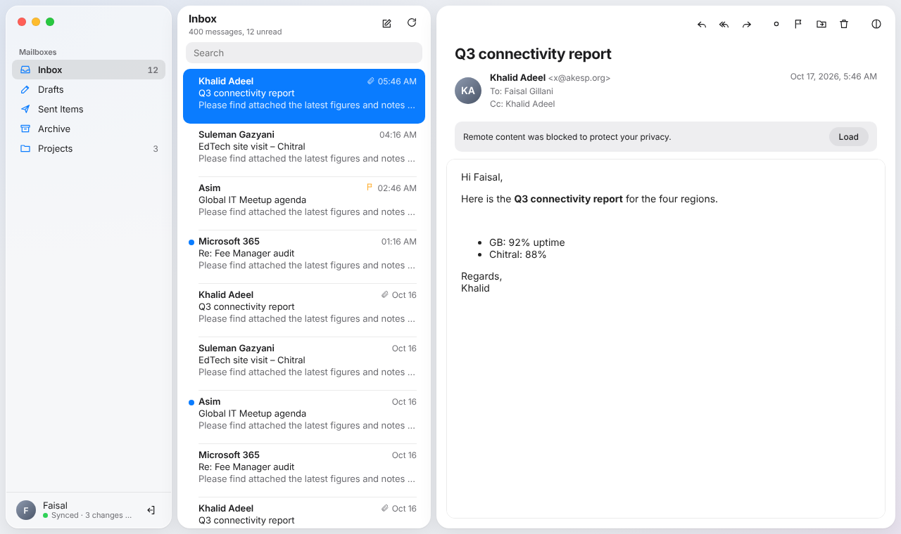
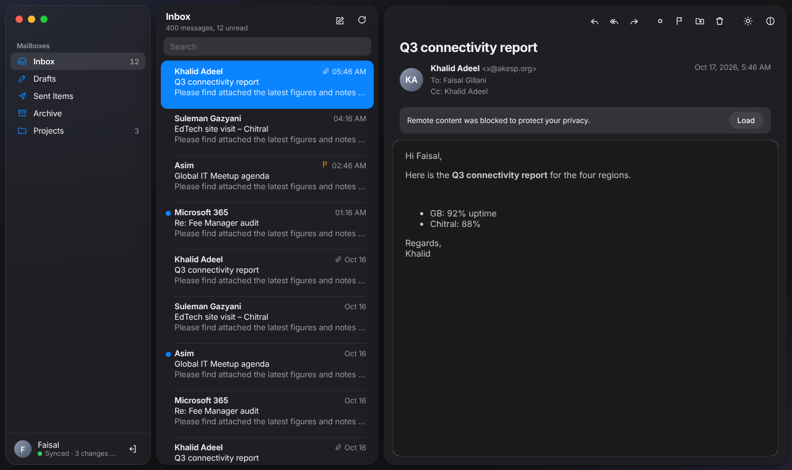
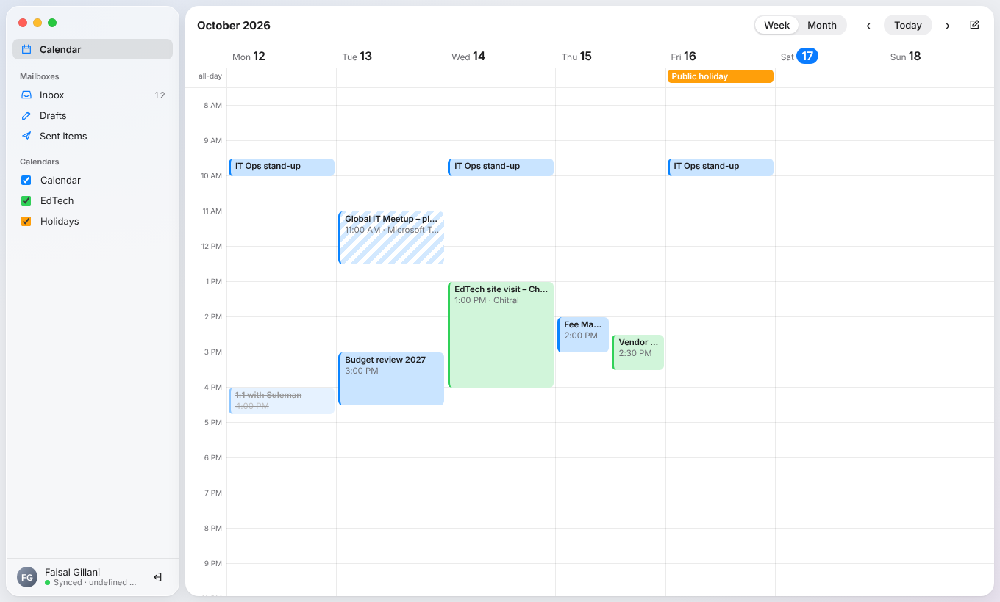

<p align="center"></p>

# Graphite Mail

A free, open-source, **offline-first Microsoft 365 and Gmail mail & calendar client for Linux**.
Built with Tauri (Rust) + React. Uses Microsoft Graph, the Gmail / Google Calendar APIs, and (for Gmail with an app password) IMAP + SMTP.

- Microsoft 365 **and Gmail**, several accounts at once, with an **All Inboxes** view
- Gmail either through Google sign-in or with a **Google app password** (IMAP/SMTP, no Google sign-in client needed)
- **Contacts** for Microsoft 365: your organisation's directory and your own contacts, searchable offline, and suggested in To/Cc;
  right-click for email, meetings, mail search, favourites, vCard export, block / rule; multi-select
- Full offline reading and search of your mailbox
- Read, flag, move, delete, reply and send while offline — changes sync when you reconnect
- You choose where your mail data is stored, and can move it safely later (crash-proof, verified copy)
- macOS-style interface with light and dark mode
- Sign-in tokens and app passwords kept in your system keyring





## Install

**Ubuntu / Debian** — download the `.deb` from the releases, then:

```
sudo apt install ./graphite-mail_<version>_amd64.deb
graphite-mail
```

**Any Linux** — download the `.AppImage`, then:

```
chmod +x graphite-mail_<version>_amd64.AppImage
./graphite-mail_<version>_amd64.AppImage
```

New to Graphite Mail? Read the **[User Guide](docs/USER-GUIDE.md)**.

## Build from source

Needs Node 20+, Rust, and on Ubuntu: `libwebkit2gtk-4.1-dev libgtk-3-dev libayatana-appindicator3-dev librsvg2-dev libssl-dev libdbus-1-dev libsecret-1-dev patchelf`.

Gmail sign-in needs your own Google OAuth "Desktop app" client. Put it in the untracked file `src-tauri/google_oauth.json`
(copy `src-tauri/google_oauth.example.json`) or set `GRAPHITE_GOOGLE_CLIENT_ID` / `GRAPHITE_GOOGLE_CLIENT_SECRET` when building.
Without it the app builds and works, but "Add Google account" says it isn't set up.
**Gmail (app password)** never uses that client or its secret, so it works in every build.

```
npm ci
npm run tauri build        # .deb and .AppImage in src-tauri/target/release/bundle/
cd src-tauri && cargo test # automated tests
```

## Microsoft 365 permissions

Graphite Mail asks for these delegated Microsoft Graph permissions:

| When | Permissions | What for |
|---|---|---|
| Sign-in | `openid profile offline_access User.Read Mail.ReadWrite Mail.Send Calendars.ReadWrite` | mail, sending, calendar |
| Home → Rules → **Allow rules** | `MailboxSettings.ReadWrite` | Outlook inbox rules |
| Contacts → **Grant access** | `Contacts.Read People.Read User.ReadBasic.All` | your contacts, the people you work with, the directory (basic profiles) |

The extra permissions are asked for only when you use the feature, so mail and calendar never depend on them.
`User.ReadBasic.All` can be granted by users in most organisations; where user consent is switched off, an administrator
has to approve Graphite Mail (or the Contacts view says the organisation doesn't allow it). Contacts are stored only in the
local database; "Remove cached contacts" (Settings) and removing the account delete them.

## Status

Mail, calendar, contacts, offline changes and data-folder moves are working. See [CHANGELOG.md](CHANGELOG.md) and [PLAN.md](PLAN.md).
